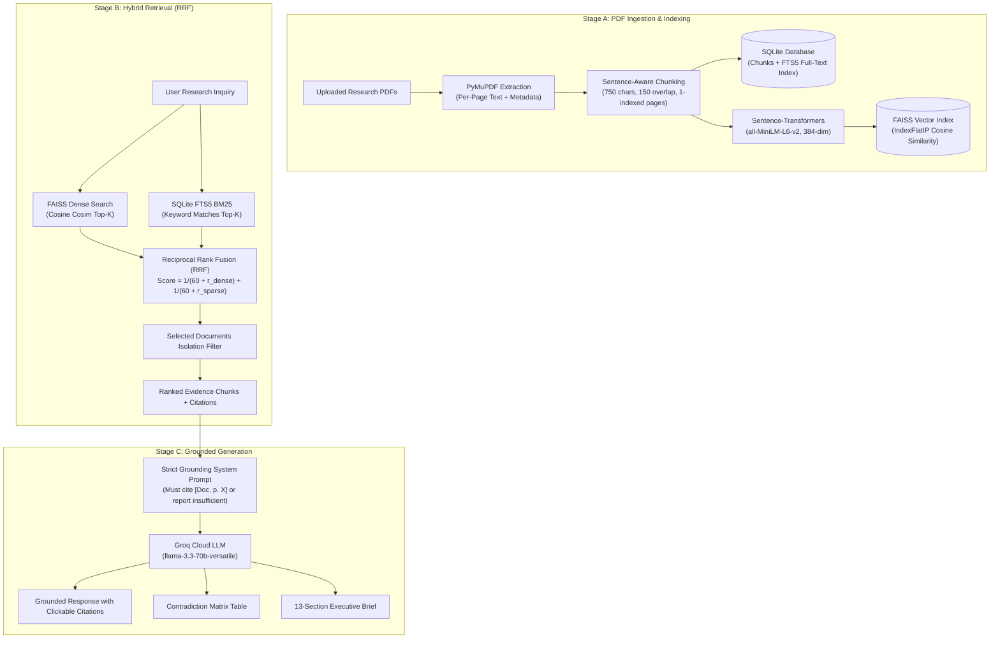

# ResearchIQ: Multi-Document Research Assistant
**Production Full-Stack Evidence-Grounded RAG Platform with Hybrid Retrieval, Contradiction Detection, and Executive Brief Synthesis**

Built for final-year engineering portfolios, academic evaluations, and technical interviews in AI & Data Science.

---

## 1. Project Overview & Problem Statement

Modern research workflows require cross-referencing dozens of long, multi-page technical reports and academic papers. Standard LLMs suffer from severe limitations:
1. **Context Window Saturation & Cost:** Feeding full raw PDFs directly into an LLM context is expensive and exceeds token limits.
2. **Parametric Hallucination:** General-purpose LLMs generate unsubstantiated figures, dates, and conclusions when answering complex domain questions.
3. **Cross-Document Inconsistencies:** Traditional RAG retrieves individual chunks in isolation, frequently missing direct empirical contradictions between competing research groups.

**ResearchIQ** solves this by implementing a production-grade, local-first RAG architecture that:
- Extracts per-page text from PDFs with PyMuPDF, preserving exact 1-indexed page metadata.
- Employs **Hybrid Retrieval** combining FAISS dense vector search (`sentence-transformers/all-MiniLM-L6-v2`) and SQLite FTS5 BM25 keyword matching via **Reciprocal Rank Fusion (RRF)**.
- Strictly grounds AI answers in retrieved evidence with clickable, verifiable citations `[Document Title, p. X]`.
- Implements a dedicated **Comparative Contradiction Engine** to categorize agreements, methodology variations, and direct empirical conflicts.
- Generates 13-section **Executive Research Briefs** with 1-click export to Markdown and styled PDF.

---

## 2. System Architecture



---

## 3. Technology Stack

### Frontend
- **Framework:** React 19 + TypeScript (strict mode)
- **Tooling:** Vite, PostCSS, Tailwind CSS
- **Icons:** Lucide React
- **Markdown & Citations:** React-Markdown + Remark-GFM
- **Serving:** Served directly by FastAPI as a high-performance static SPA bundle (`/`).

### Backend & RAG Pipeline
- **API Framework:** FastAPI, Uvicorn, Pydantic v2
- **PDF Extraction:** PyMuPDF (`fitz`) for per-page extraction and encryption validation
- **Embeddings:** `sentence-transformers/all-MiniLM-L6-v2` (384-dimensional dense vectors)
- **Vector Database:** FAISS (`faiss-cpu`, `IndexFlatIP` on unit-normalized vectors)
- **Keyword Retrieval:** SQLite FTS5 with BM25 ranking
- **Hybrid Fusion:** Reciprocal Rank Fusion (RRF with \(k=60\))
- **LLM Inference:** Groq Cloud API (`llama-3.3-70b-versatile`, `llama-3.1-8b-instant`)
- **PDF Generation:** ReportLab for compiling 13-section research briefs into standalone PDFs
- **Testing:** `pytest` test suite

---

## 4. Folder Structure

```
ResearchIQ/
├── backend/
│   ├── api/
│   │   ├── dashboard.py           # Database aggregate statistics
│   │   ├── documents.py           # Upload, extraction, indexing pipeline
│   │   ├── research.py            # Chat sessions & grounded Q&A
│   │   ├── comparison.py          # Cross-document contradiction analysis
│   │   ├── reports.py             # Executive brief synthesis & PDF export
│   │   ├── settings.py            # API key & vector storage diagnostics
│   │   └── evaluation.py          # Empirical HitRate@K & Recall benchmark
│   ├── services/
│   │   ├── pdf_service.py         # PyMuPDF extraction & page retention
│   │   ├── chunking_service.py    # Sentence-aware overlapping chunker
│   │   ├── embedding_service.py   # Sentence-Transformers embeddings
│   │   ├── retrieval_service.py   # FAISS dense + SQLite FTS5 hybrid RRF
│   │   ├── rag_service.py         # Groq LLM grounded synthesis
│   │   ├── comparison_service.py  # Cross-document claim extraction
│   │   ├── report_service.py      # 13-section brief compiler & PDF exporter
│   │   └── evaluation_service.py  # HitRate, Recall, Citation coverage
│   ├── tests/
│   │   ├── test_database.py
│   │   ├── test_pdf_and_chunking.py
│   │   ├── test_embeddings_and_retrieval.py
│   │   ├── test_api_endpoints.py
│   │   └── test_reports_and_comparison.py
│   ├── config.py                  # Environment settings & storage paths
│   ├── database.py                # SQLite schema & FTS5 virtual tables
│   ├── models.py                  # Pydantic schemas
│   └── main.py                    # FastAPI application & SPA static mount
├── frontend/
│   ├── src/
│   │   ├── components/            # Sidebar, Topbar, Workspace panels, Badges, Modals
│   │   ├── pages/                 # Dashboard, Documents, Workspace, Compare, Reports, Evaluation, Settings
│   │   ├── services/api.ts        # Centralized typed API client
│   │   ├── types/index.ts         # TypeScript interfaces
│   │   ├── App.tsx
│   │   └── main.tsx
│   ├── dist/                      # Pre-compiled production React SPA bundle
│   └── package.json
├── storage/
│   ├── uploads/                   # Uploaded PDFs & sample papers
│   ├── indexes/                   # FAISS vector indexes (.bin) and ID mappings
│   └── exports/                   # Exported research reports (.md and .pdf)
├── scripts/
│   └── generate_sample_docs.py    # Generates 3 academic sample papers
├── .env.example
├── .gitignore
├── requirements.txt
├── pytest.ini
├── run.bat                        # Windows 1-command startup
├── setup.bat                      # Optional upfront environment setup
└── README.md
```

---

## 5. One-Command Windows Quickstart

### Prerequisites
- **Python 3.10+ or 3.11+** installed and added to PATH.
- **Node.js (v18+)** installed and added to PATH.

### Launching the Application
1. Double-click or run:
   ```cmd
   run.bat
   ```
2. The script will:
   - Verify Python and Node.js.
   - Reuse/create virtual environment (`.venv`) and install dependencies if needed.
   - Verify the pre-built React frontend.
   - Ensure the 3 sample academic research papers are generated and indexed.
   - Start the FastAPI server on `http://127.0.0.1:8000`.
   - Open your default web browser automatically to the dashboard!

---

## 6. How RAG & Hybrid Retrieval Work

### 1. Per-Page Extraction & Chunking
When a PDF is uploaded, PyMuPDF iterates page by page. Text chunks are generated using sentence-aware boundary detection (`chunk_size=750`, `chunk_overlap=150`). Each chunk records its originating document ID, document title, and exact 1-indexed page number.

### 2. Dense Embeddings & FAISS
Chunks are converted into 384-dimensional dense vectors using `all-MiniLM-L6-v2`. Embeddings are \(L_2\) unit-normalized. Similarity search uses `faiss.IndexFlatIP`, where the inner product of normalized vectors equals exact Cosine Similarity.

### 3. Sparse Keyword Matching & FTS5
Concurrently, chunk texts are indexed in a SQLite FTS5 full-text virtual table (`document_chunks_fts`). Keyword queries match specific terms using SQLite BM25 ranking.

### 4. Reciprocal Rank Fusion (RRF)
To prevent semantic drift or missing exact terms (e.g. acronyms, model names, numbers), ResearchIQ applies Reciprocal Rank Fusion:
$$\text{RRF Score}(d) = \frac{1}{k + \text{rank}_{\text{dense}}(d)} + \frac{1}{k + \text{rank}_{\text{sparse}}(d)}$$
with $k = 60$. Only chunks from user-selected documents are admitted to the ranking pool.

### 5. Grounded LLM Generation
The top ranked chunks are assembled into an evidence context block. The LLM is instructed under a strict academic system prompt to cite `[Document Title, p. X]` for each empirical claim. If the evidence is insufficient, it explicitly returns an insufficient evidence notice rather than hallucinating.

---

## 7. Sample Research Papers (Included)

The platform comes with 3 sample academic research papers to test RAG and contradiction detection immediately:

1. **`Solid_State_Batteries_Vance_2024.pdf`** (Dr. Elena Vance, Zurich):
   - Claims LLZO ceramic electrolytes achieve **84.5% capacity retention after 2,000 cycles at 4C** charging rate.
   - Recommends pack pre-heating to **45°C** to lower interfacial impedance.
   - Projects pack costs dropping to **$72/kWh by 2027**.

2. **`Automotive_Cell_Degradation_Chen_2023.pdf`** (Prof. Marcus Chen, Tokyo):
   - Directly contradicts Vance: finds capacity drops to **63.8% after only 850 cycles at 4C**.
   - Explicitly warns that operating above **40°C** causes severe electrolyte decomposition.
   - Projects commercial costs will remain above **$115/kWh through 2030**.

3. **`Grid_EV_Integration_Jenkins_2024.pdf`** (Dr. Sarah Jenkins, Berkeley):
   - Evaluates 350 kW DC fast-charging impacts on urban distribution substations.
   - Recommends 1 MWh BESS buffer stations to eliminate \$1.2M grid upgrade connection fees.

---

## 8. Academic Evaluation Benchmark

ResearchIQ features an automated academic benchmark page measuring:
- **Retrieval Hit Rate@K:** Proportion of test queries where relevant evidence appears in top-$K$.
- **Mean Recall@K:** Proportion of key experimental topics matched in retrieved context.
- **Citation Coverage:** Percentage of claims backed by verifiable document titles and 1-indexed page citations.

Run tests programmatically:
```bash
python -m pytest backend/tests/ -v
```

All 11 tests pass in ~30 seconds, covering database integrity, PDF extraction, chunk metadata, embeddings, isolation filters, API endpoints, and PDF report compilation.

---

## 9. API Reference

FastAPI provides interactive Swagger documentation at `http://127.0.0.1:8000/docs`.

| Endpoint | Method | Description |
|---|---|---|
| `/api/health` | GET | System status and LLM configuration check |
| `/api/dashboard/stats` | GET | Real database statistics |
| `/api/documents` | GET | List documents with search, filter, and sorting |
| `/api/documents/upload` | POST | Upload and index multiple PDF files |
| `/api/documents/{id}` | GET | Document detail and chunk inspector |
| `/api/documents/{id}` | DELETE | Delete document and safely re-index vectors |
| `/api/documents/seed-samples` | POST | 1-click seed sample papers |
| `/api/research/sessions` | POST / GET | Create or list research sessions |
| `/api/research/sessions/{id}/chat`| POST | Evidence-grounded chat with citations |
| `/api/research/compare` | POST | Cross-document contradiction analysis |
| `/api/reports/generate` | POST | Synthesize 13-section research brief |
| `/api/reports/save` | POST | Save brief to SQLite |
| `/api/reports/{id}/export` | GET | Export brief as Markdown or styled PDF |
| `/api/evaluation/benchmark` | GET | Run academic retrieval metrics benchmark |
| `/api/settings` | GET / POST | Manage Groq API key and model |
| `/api/settings/test-connection` | POST | Test Groq connection |
| `/api/settings/rebuild-index` | POST | Rebuild FAISS index from stored chunks |

---

## 10. License

MIT License. Designed for academic research and educational evaluation.
